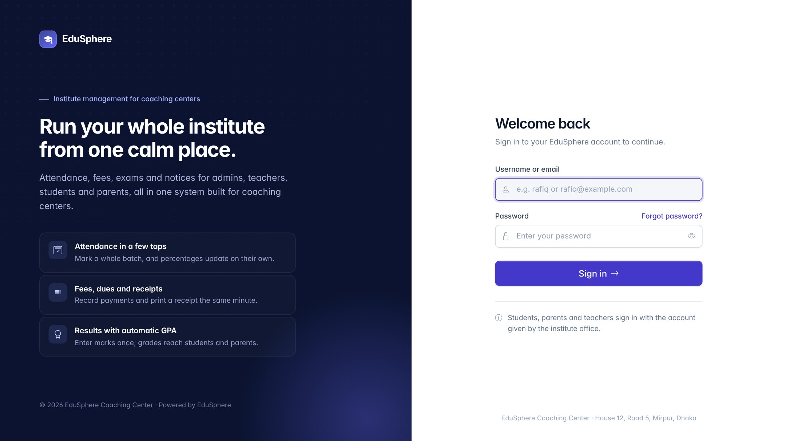
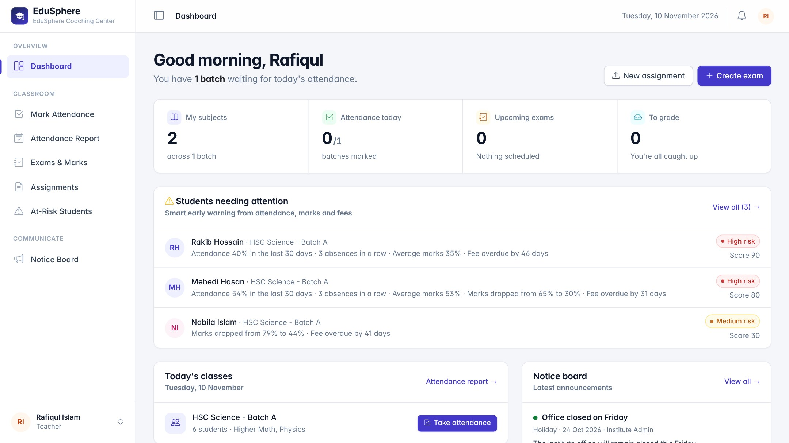
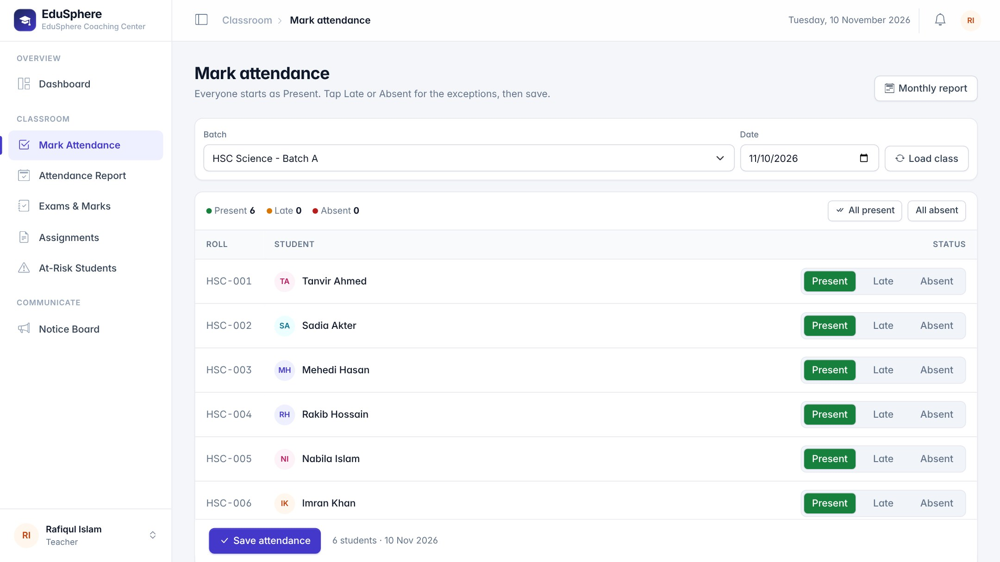
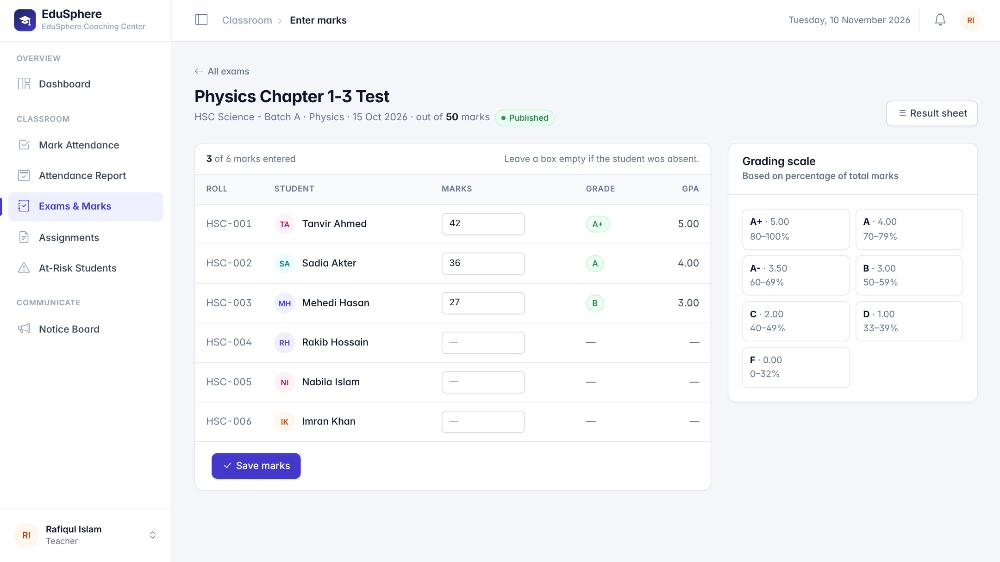
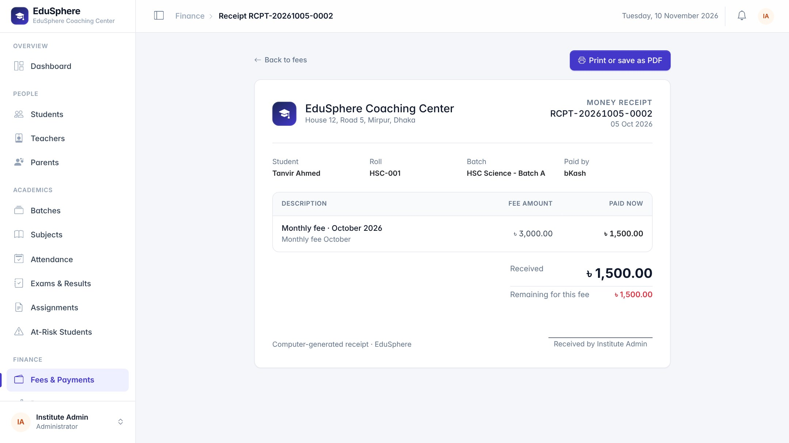
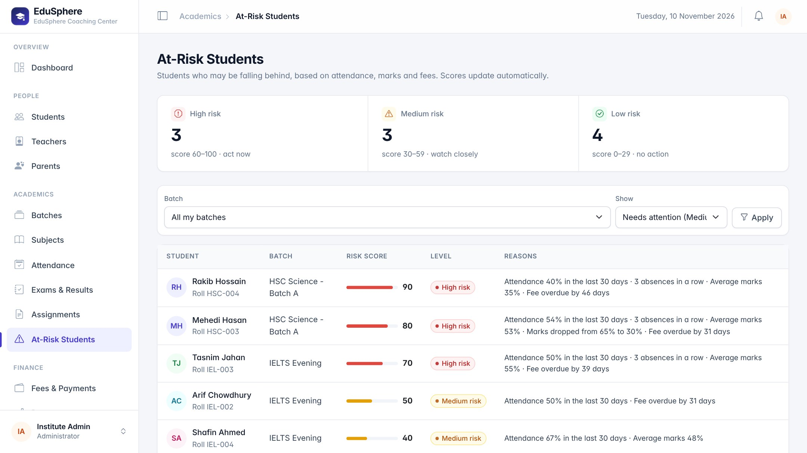
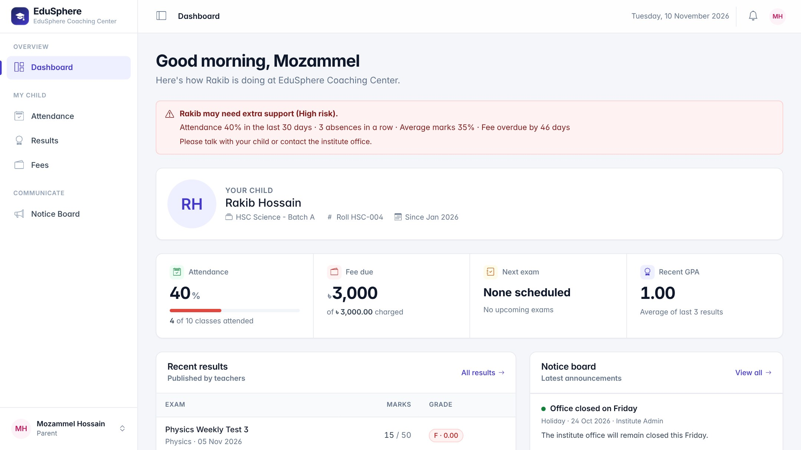

# EduSphere AI – Smart Coaching & Institute Management System

A web-based management system for small coaching centres and institutes. One website serves four
roles – **Admin, Teacher, Student and Parent** – and replaces paper registers, fee ledgers and
WhatsApp notices. Its smart feature, the **At-Risk Student Early Warning**, flags students who are
falling behind so staff and parents can step in early.

Course project for **CSE0613316 – Software Project Design and Development Lab**, Autumn 2026,
University of Information Technology and Sciences (UITS).

   

---

## Contents

1. [The problem](#1-the-problem)
2. [Features by role](#2-features-by-role)
3. [Screenshots](#3-screenshots)
4. [How it works](#4-how-it-works)
5. [The at-risk early warning](#5-the-at-risk-early-warning)
6. [Installation (XAMPP)](#6-installation-xampp)
7. [Demo accounts](#7-demo-accounts)
8. [Running the tests](#8-running-the-tests)
9. [Security](#9-security)
10. [Folder structure](#10-folder-structure)
11. [Team – who did what](#11-team--who-did-what)
12. [Limitations and future work](#12-limitations-and-future-work)

---

## 1. The problem

Most small coaching centres in Bangladesh keep attendance on paper, fees in a ledger and notices in
WhatsApp groups. Nothing is connected, so a parent usually finds out that a child is missing classes
or failing tests only when it is too late. EduSphere puts everything in one place and turns the data
that is already being collected into an early warning.

**Objectives**

1. Manage students, teachers, parents, batches and subjects from one admin panel.
2. Take attendance quickly (one click per student, saved with AJAX).
3. Record fees and payments, calculate dues automatically and print receipts.
4. Enter marks once and get grades and GPA automatically.
5. Give each role its own dashboard with only the data it is allowed to see.
6. Warn staff and parents early when a student is at risk.

---

## 2. Features by role

| Role | What they can do |
|---|---|
| **Admin** | Add, edit, search and deactivate students, teachers and parents (with photos) · create batches and subjects and assign teachers · add fees for one student or a whole batch, collect payments, print receipts · see the due list · post notices · view reports (attendance, income, dues, student and teacher summaries) with CSV export and print-to-PDF · **At-Risk Students** page · dashboard with totals and charts |
| **Teacher** | Mark attendance for own batches (Present / Absent / Late) · create exams and enter marks (grade and GPA are calculated) · upload assignments (PDF), review submissions and give marks and feedback · post notices · see the at-risk students in own batches |
| **Student** | Own attendance with percentage · results and GPA · fees, dues and payment history · download assignments and submit work · notices |
| **Parent** | Child's attendance, results, fees and notices · **an alert on the dashboard when the child is at risk**, with the reasons |

Shared features: login with username or email, logout, forgot / reset password, change password,
lockout after 5 wrong passwords, responsive layout that works on phones.

---

## 3. Screenshots

| | |
|---|---|
|  <br> **Login** |  <br> **Teacher dashboard** |
|  <br> **Mark attendance (AJAX)** |  <br> **Marks entry with automatic grade** |
|  <br> **Fee receipt** |  <br> **At-Risk Students (admin)** |
|  <br> **Parent dashboard with risk alert** | |

Design diagrams: [Use case diagram](docs/usecase.png) · [ER diagram](docs/er.png)

---

## 4. How it works

### 4.1 Architecture

EduSphere is a classic three-layer PHP application. There is no framework: every page is a PHP file
that loads a few shared includes.

```
 Browser (HTML + Bootstrap 5 + JavaScript / AJAX + Chart.js)
        │  HTTP request (form POST, link, or AJAX call)
        ▼
 Apache + PHP 8  (XAMPP)
   page.php ─► includes/functions.php   helpers, login checks, CSRF, GPA, dues, risk score
            ─► includes/db.php          one PDO connection (prepared statements)
            ─► includes/header.php      layout + sidebar for the user's role
        │  SQL
        ▼
 MySQL / MariaDB  –  database "edusphere", 15 tables in 3NF
```

### 4.2 What happens on every page

Every protected page starts the same way:

```php
require_once __DIR__ . '/../includes/functions.php';
require_role(['admin', 'teacher']);   // anyone else is sent away
```

1. **Session check** – `require_role()` checks that the user is logged in and has one of the allowed
   roles. If not, they are redirected to the login page or the dashboard. This is done on the
   server, so hiding a menu link is never the only protection.
2. **Form submitted?** – for a POST request the page first checks the CSRF token with
   `csrf_check()`, then validates the input, then saves it with a prepared statement.
3. **Read data** – the page runs its `SELECT` queries through PDO.
4. **Show the page** – `header.php` draws the sidebar for that role, the page prints its content
   (every value passes through `e()` to block XSS), and `footer.php` closes the layout.
5. **Flash message** – after saving, the page redirects and shows a toast ("Saved", "Deleted", …).
   This also stops a form being submitted twice on refresh.

### 4.3 Example flows

**Marking attendance (AJAX)**
`attendance/mark.php` shows the batch list → the teacher clicks Present / Absent / Late → JavaScript
sends the choice to `attendance/save.php` with the CSRF token → `save.php` checks that this teacher
teaches this batch, saves the row (one mark per student per day) and returns JSON → the page updates
without reloading.

**Fees and dues**
The admin adds a fee in `fees/add.php` (for one student or a whole batch) → payments are recorded in
`fees/collect.php` → the **due is never stored**, it is always calculated as
*fee amount − sum of payments*, so it can never be out of date → `fees/receipt.php` prints a receipt.

**Exams and GPA**
The teacher creates an exam in `exams/form.php` and enters marks in `exams/marks.php` →
`calc_grade()` turns the percentage into a grade and GPA on the 5.00 scale →
students and parents see published results in `exams/my.php`.

| Percentage | 80+ | 70–79 | 60–69 | 50–59 | 40–49 | 33–39 | below 33 |
|---|---|---|---|---|---|---|---|
| Grade (GPA) | A+ (5.00) | A (4.00) | A- (3.50) | B (3.00) | C (2.00) | D (1.00) | F (0.00) |

"Late" counts as attended in the attendance percentage.

### 4.4 Database

15 tables, normalised to third normal form (`database/edusphere.sql`).

| Group | Tables |
|---|---|
| People | `users` (one login for every role) → `students`, `teachers`, `parents` |
| Classes | `batches`, `subjects`, `teacher_subjects` (which teacher teaches which subject in which batch) |
| Daily work | `attendance`, `exams`, `results`, `assignments`, `submissions`, `notices` |
| Money | `fees`, `payments` (the due is calculated, never stored) |

---

## 5. The at-risk early warning

`risk_score()` in `includes/functions.php` gives each student a score from **0 to 100** from three
things the institute already records. The rules are simple on purpose, so every score can be
explained to a parent.

| Area | Rule | Points |
|---|---|---|
| **Attendance** (max 40) | Attendance below 60% / below 75% / below 85% | 30 / 20 / 10 |
| | Absent in the last 3 classes in a row | +10 |
| **Marks** (max 40) | Average below 40% / below 50% / below 60% | 30 / 20 / 10 |
| | Latest result is 15+ points below the average of the two before it | +10 |
| **Fees** (max 20) | A fee overdue more than 30 days / 1–30 days | 20 / 10 |

| Score | Level |
|---|---|
| 60 or more | 🔴 **High** |
| 30 – 59 | 🟠 **Medium** |
| below 30 | 🟢 **Low** |
| fewer than 5 classes and no results | ⚪ **Not enough data** (new students are not labelled) |

Every point comes with a plain-language reason, for example *"Attendance is 44% (below 60%)"* or
*"Absent in the last 3 classes"*.

**Who sees what**

- **Admin** – the *At-Risk Students* page (`admin/at_risk.php`) lists every student with score,
  level and reasons, with filters, plus a widget on the dashboard.
- **Teacher** – the same widget, limited to the teacher's own batches.
- **Parent** – an alert on the dashboard when their child is Medium or High risk, with the reasons.
- **Student** – never sees a risk label. They see their own attendance, marks and fees, which are
  the same facts the score is built from. This was a deliberate choice so a student is not
  discouraged by a label.

The score is calculated live every time a page is opened (about 4 queries per student), so it is
always up to date and nothing extra is stored.

---

## 6. Installation (XAMPP)

**Requirements:** XAMPP with PHP 8.1 or newer and MySQL/MariaDB, a modern browser, internet access
(Bootstrap, Bootstrap Icons, Chart.js and the fonts load from a CDN).

1. Copy (or `git clone`) the project into `C:\xampp\htdocs\edusphere`, so that
   `C:\xampp\htdocs\edusphere\login.php` exists.
2. Start **Apache** and **MySQL** in the XAMPP Control Panel.
3. Open <http://localhost/phpmyadmin> → **Import** → choose `database/edusphere.sql` → **Go**.
   The file creates the `edusphere` database itself.
4. *(Optional, for the at-risk demo)* select the `edusphere` database → **SQL** tab → run
   `database/demo_at_risk.sql`, then `database/demo_at_risk_more.sql`. Dates are relative to today,
   so the demo always looks recent.
5. Open <http://localhost/edusphere>.

If your MySQL password is not empty or you used a different folder name, change `DB_PASS` or
`BASE_URL` in `config/config.php`.

---

## 7. Demo accounts

All data is fake demo data.

| Role | Username | Password | Notes |
|---|---|---|---|
| Admin | `admin` | `admin123` | |
| Teacher | `teacher1` | `teacher123` | also `teacher2` |
| Student | `student1` | `student123` | Tanvir Ahmed; also `student2`–`student5` |
| Parent | `parent1` | `parent123` | child: student1 |
| Parent | `parent2` | `parent123` | child: Rakib Hossain – **High** risk (after the demo SQL) |
| Parent | `parent3` | `parent123` | child: Nabila Islam – **Medium** risk (after the demo SQL) |

You can log in with the username **or** the email address.

---

## 8. Running the tests

**74 tests, 136 assertions, all passing.** PHPUnit is included as `phpunit.phar`, so nothing has to
be installed.

```bat
run_tests.bat
```

or

```bash
php phpunit.phar
```

| Suite | Files | Tests |
|---|---|---|
| Unit | Grade (13), FeeStatus (4), Helpers (15), SessionAndCsrf (8) | 40 |
| Database | Access (5), Attendance (6), Fee (6), Notice (5), Results (1), User (11) | 34 |

The tests **never touch your real data**. `phpunit.xml` sets `DB_NAME=edusphere_test`, and
`tests/bootstrap.php` drops and rebuilds that database from `database/edusphere.sql` at the start of
every run. See [TESTING.md](TESTING.md) for the details of each test.

---

## 9. Security

| Threat | Protection |
|---|---|
| Stolen passwords | bcrypt hashing (`password_hash` / `password_verify`) |
| Guessing passwords | lockout for 15 minutes after 5 wrong tries |
| SQL injection | PDO prepared statements on every query |
| XSS | every output goes through `e()` (`htmlspecialchars`) |
| CSRF | a token on every form and on the AJAX attendance call |
| Session hijacking | session ID regenerated on login |
| Opening another role's page | `require_role()` on the server for every page; teachers can only manage their own batches |
| Malicious uploads | extension and size checks (max 5 MB), random file names, scripts blocked in `uploads/` by `.htaccess`, downloads go through a permission check in `download.php` |
| Reading config or SQL files from the browser | `.htaccess` denies `config/`, `includes/` and `database/` |

---

## 10. Folder structure

```
edusphere/
├── index.php, login.php, logout.php        entry and sign-in
├── forgot_password.php, reset_password.php, change_password.php
├── dashboard.php                           loads the dashboard for the user's role
├── download.php                            permission-checked file download
├── config/config.php                       database settings, app name, security settings
├── database/
│   ├── edusphere.sql                       15 tables + demo data
│   └── demo_at_risk*.sql                   extra demo data for the at-risk feature
├── includes/
│   ├── db.php                              PDO connection
│   ├── functions.php                       helpers, require_role(), CSRF, GPA, dues, risk_score()
│   ├── header.php, footer.php              app layout and role-based sidebar
│   ├── auth_header.php, auth_footer.php    layout of the sign-in pages
│   └── dashboards/                         admin, teacher, student, parent, notices and risk widgets
├── admin/          students, teachers, parents, batches, subjects, at_risk
├── attendance/     mark (AJAX), save (JSON endpoint), report, my
├── fees/           list and dues, add, collect, receipt, my
├── exams/          exams, marks entry, result sheet, my results
├── assignments/    upload, submissions, view and submit
├── notices/        notice board
├── reports/        attendance, income, dues, student and teacher reports
├── assets/         css/style.css (design tokens), js/app.js
├── uploads/        photos, assignments, submissions (protected)
├── tests/          Unit/ and Database/ PHPUnit tests
├── docs/           screenshots and diagrams
└── phpunit.xml, phpunit.phar, run_tests.bat, composer.json, TESTING.md
```

---

## 11. Team – who did what

**Supervisor:** Engineer Md. Safaet Hossain, Director, IQAC & Associate Professor, UITS

| Member | ID | Role | Main contributions |
|---|---|---|---|
| **Saif Hasan Ome** | 04324205101154 | Group Leader | Database design (ER diagram, 15-table schema, demo data), UML and design diagrams (use case, DFD, activity, architecture, sequence), some back-end work, project planning and coordination |
| **Md. Mahbub Alam** | 04324205101151 | Member | UI design: design system (colours, type, spacing), page layouts and dashboard designs, screen mock-ups |
| **Abrar Rahman** | 04324205101190 | Member | UI and front end: Bootstrap pages, responsive layout, sidebar and sign-in pages, JavaScript (toasts, confirmations, table search, CSV export), Chart.js charts |
| **Md. Minhazul Islam** | 04324205101203 | Member | Most of the back end: login and role-based access, attendance (AJAX), fees and dues, exams and GPA, assignments, reports, and the **at-risk early-warning logic** (`risk_score()`); PHPUnit unit and database tests, security checks, live demo |

Everyone took part in the requirements (SRS), the report and the presentation.

---

## 12. Limitations and future work

**Current limitations**

- No email service yet, so the password-reset link is shown on screen (`SHOW_RESET_LINK` in
  `config/config.php`). The admin can also reset any password.
- Payments are entered by the admin; there is no online payment gateway.
- PDF export uses the browser's *Print → Save as PDF*.
- One batch per student, one child per parent account, one institute.
- Runs on localhost (XAMPP); not deployed publicly yet, no CI server, test coverage not measured.

**Future work**

- SMS / email alerts to parents when a child becomes High risk.
- bKash / Nagad online payments.
- Bangla language option and a mobile app.
- Multiple children per parent and multiple branches.
- Public hosting with HTTPS and automatic tests on every push (GitHub Actions).

